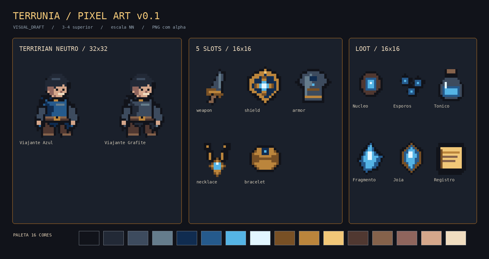

# Terrúnia — Grade Pixel Art v0.1

**Status: `VISUAL_DRAFT`.** Perspectiva 3/4 superior. Esta é uma convenção técnica inicial de produção, não uma nova regra de cânone ou de progressão.

## Matriz

| Grupo | Canvas nativo | Aplicação |
|---|---:|---|
| Tiles de cenário | 16×16 | Base modular |
| Personagem | 32×32 | Silhueta até 24 px de largura, âncora nos pés |
| Ícone de item | 16×16 | Inventário, prévias de Vínculo e loot |
| Criatura grande | 48×48 ou 64×64 | `VISUAL_DRAFT`, ainda sem sprite implementado |
| Retrato especial | 64×64 | `VISUAL_DRAFT`, ainda sem sprite implementado |
| Módulo de moldura | 8×8 | Repetição e 9-slice futura |

- Desenhar e versionar sempre a resolução nativa em PNG RGBA com alpha transparente.
- Não desenhar linhas de grade nos assets do jogo.
- Ampliar com `image-rendering: pixelated` e, quando o layout permitir, escalas inteiras de 2×, 3×, 4× ou 6×.
- Até 16 cores visíveis por sprite, sem antialiasing nem transparência parcial nas bordas.
- Evitar detalhes menores que 1 pixel e ruído visual no rosto, nos símbolos e nos materiais.
- O personagem-base é um **Terrírian sem Clã e sem Classe**. As variantes de manto são visuais, sem efeitos mecânicos.

## Paleta-base (16 cores)

| Uso | Tons |
|---|---|
| Contorno/sombra | `#11131A` `#222936` |
| Aço | `#3D4B5E` `#657C8C` |
| Azul | `#102C50` `#255A8C` |
| Runa | `#55B4E5` `#E2F6FF` |
| Ouro | `#785025` `#BB853C` `#F1C778` |
| Couro | `#503831` `#85624B` |
| Pele | `#8F655D` `#D5A78B` `#F0DDC0` |

## Assets v0.1

**Personagem:**

- `character.terririan.default` → `characters/terririan/player_default.png` (32×32, 3/4 superior, manto azul)
- `character.terririan.sigil` → `characters/terririan/player_sigil.png` (32×32, 3/4 superior, manto grafite)

**Prévia dos cinco tipos de Vínculo:**

- `equipment.slot-preview.weapon`
- `equipment.slot-preview.shield`
- `equipment.slot-preview.armor`
- `equipment.slot-preview.necklace`
- `equipment.slot-preview.bracelet`

Essas prévias ficam propositalmente esmaecidas enquanto o slot estiver vazio. Não constituem escolhas de equipamento na criação e **não criam nenhuma instância vinculada**. Os cinco slots seguem permanentes; a única arma obtida no vertical slice aparece após o evento do prólogo, conforme regra existente.

**Itens de inventário:** os seis `iconAssetId` já cadastrados foram preenchidos com PNGs nativos de 16×16 sem alterar os respectivos `ItemDefinition`, recompensas, raridades ou ações. Inventário inicial permanece vazio.

## Substituição e reprodução

Os componentes consomem somente IDs do `src/assets/assetRegistry.ts`. As imagens podem ser substituídas individualmente, sem dependência mecânica dos pixels. `AssetImage` continua mostrando fallback SVG se um arquivo não existir.

Com Pillow instalado, execute `python3 scripts/build_pixel_assets.py` na raiz para reproduzir esta primeira rodada. Alterações artísticas devem preservar os nomes de arquivo ou atualizar o registro central e os testes.

## Próximo passo

Fazer a primeira folha animada do Terrírian neutro (quatro direções, idle e caminhada), definindo âncora e duração dos frames antes de criar os outros Clãs. Não confundir a escolha de cor do personagem com aquisição de Clã ou Classe.
