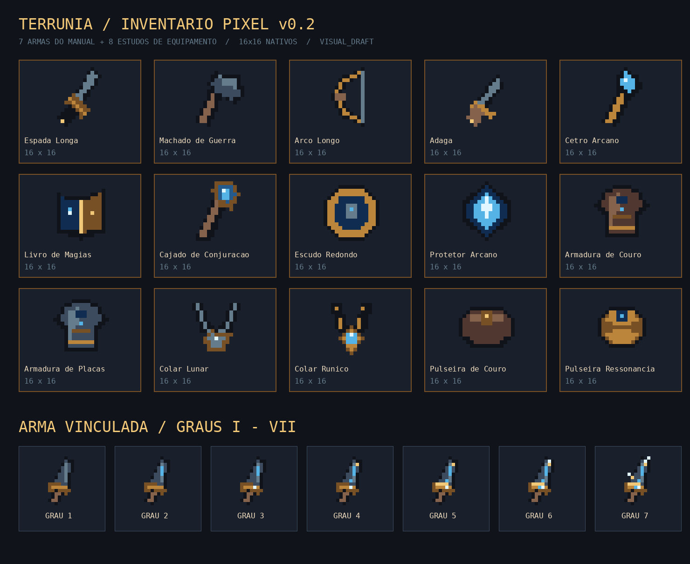

# Terrúnia — Inventário Pixel Art v0.2

Status **`VISUAL_DRAFT`**. Continuação da grade `docs/PIXEL_ART_GUIDE_v0.1.md`.

## Interface `/inventory`

1. **Personagem:** sprite neutro 32×32 e contagem de recursos realmente possuídos.
2. **Vínculos:** exatamente cinco slots permanentes, com Grau e arte da peça somente quando obtida. Slots vazios continuam vazios.
3. **Mochila:** `GameSave.inventory` como fonte de verdade; conversão, venda e bloqueios existentes continuam funcionando. O save inicial não recebe itens de demonstração.
4. **Arsenal visual:** 15 sprites 16×16 organizados por tipo, selecionáveis somente para inspeção artística. Não criam `ItemDefinition`, instância no inventário, bonus ou ação de equipar.

## Sprites de equipamentos (16×16, PNG RGBA, alpha sem antialiasing)

As sete armas nomeadas no Manual v2.2 estão reproduzidas com IDs visuais estáveis:

| ID de catálogo | Arma |
|---|---|
| `weapon_long_sword` | Espada Longa |
| `weapon_war_axe` | Machado de Guerra |
| `weapon_long_bow` | Arco Longo |
| `weapon_dagger` | Adaga |
| `weapon_arcane_scepter` | Cetro Arcano |
| `weapon_spellbook` | Livro de Magias — Projéteis |
| `weapon_conjuration_staff` | Cajado de Conjuração |

Oito **estudos visuais** ainda sem definição de item no jogo: Escudo Redondo, Protetor Arcano, Armadura de Couro, Armadura de Placas, Colar Lunar, Colar Rúnico, Pulseira de Couro e Pulseira de Ressonância. Todos `VISUAL_DRAFT`, sem mudança de cânone.

A arma base vinculada do prólogo agora possui ícones distintos nos **sete Graus**, usando o mesmo `baseItemId`; esses sprites não acrescentam novas armas.

## Estrutura técnica

- `src/content/visualEquipment.ts`: nomes, grupos, descrições, IDs e caminhos de imagem.
- `src/assets/assetRegistry.ts`: registro de todos os PNGs e fallback.
- `src/ui/screens/InventoryScreen.tsx`: rota principal de inventário.
- `src/ui/dashboard/EquipmentCatalog.tsx`: navegação puramente visual.
- `scripts/build_pixel_assets.py`: geração reproduzível das matrizes 16×16 e da prancha de revisão.
- `src/assets/assetRegistry.test.ts`: valida IDs, slots, dimensões, existência e formato RGBA.

Para regenerar: `python3 scripts/build_pixel_assets.py` na raiz. Cada arquivo possui resolução nativa exata. Ampliar sempre por escala inteira usando `image-rendering: pixelated`.

## Fora do escopo desta rodada

- criação de recompensas, novas armas obtidas, equipar/trocar Vínculos ou sistemas de crafting;
- arcos de animação, sprites 3/4 em múltiplas direções e sprites 32×32 de equipamento vestido no personagem;
- aprovação canônica de nomes/artes de conceito.

Próxima etapa sugerida: composição por camadas no personagem 32×32 (corpo + vestimenta + arma vinculada), com âncoras padronizadas por direção e testes de sobreposição, sem vincular lógica ao PNG.
